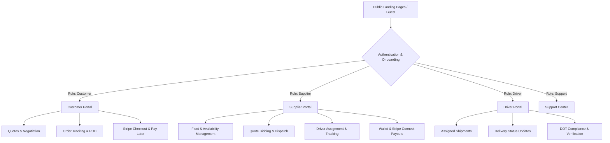

# CarrierDirect Frontend

<div align="center">

  <h3>Enterprise Freight Logistics, Fleet Management & Carrier Direct-Dispatch Platform</h3>

  <p>
    A scalable, multi-role web platform built for modern freight transport. Connects Shippers (Customers), Logistics Carriers (Suppliers), Drivers, and Dispatchers with real-time tracking, bidding, payments, and messaging.
  </p>

  <p>
    
    
    
    
    
    
  </p>

</div>

---

## 📋 Table of Contents

- [Overview](#-overview)
- [System Architecture & Portals](#-system-architecture--portals)
  - [1. Customer Portal (Shipper)](#1-customer-portal-shipper)
  - [2. Supplier Portal (Carrier)](#2-supplier-portal-carrier)
  - [3. Driver Portal](#3-driver-portal)
  - [4. Auth & Security Module](#4-auth--security-module)
- [Key Features](#-key-features)
- [Tech Stack](#-tech-stack)
- [Project Structure](#-project-structure)
- [Getting Started](#-getting-started)
  - [Prerequisites](#prerequisites)
  - [Installation](#installation)
  - [Environment Variables](#environment-variables)
  - [Development Server](#development-server)
  - [Production Build](#production-build)
- [Available Scripts](#-available-scripts)
- [Real-Time & WebSocket Configuration](#-real-time--websocket-configuration)
- [Code Style & Conventions](#-code-style--conventions)
- [Git Workflow](#-git-workflow)

---

## 🚀 Overview

**CarrierDirect** is an end-to-end logistics SaaS platform engineered to eliminate friction between freight shippers and carrier fleets. It features an automated quote-to-delivery lifecycle, enabling instant quote comparisons, multi-round price negotiations, real-time dispatch, proof-of-delivery (POD) tracking, and integrated Stripe/Pay-Later financing.

---

## 🏢 System Architecture & Portals

The application implements a strict **Role-Based Access Control (RBAC)** architecture separated into dedicated role portals:



### 1. Customer Portal (Shipper)
* **Quote Management**: Create detailed freight requests, receive bids from verified carriers, review pricing breakdowns, and negotiate rates in real-time.
* **Order & Dispatch Tracking**: Monitor cargo from pickup to drop-off with interactive Leaflet map integration and milestone tracking.
* **Flexible Finance**: Secure Stripe card payments, invoice management, billing histories, and an integrated **Pay-Later Facility**.
* **Direct Messaging**: Threaded live chat with suppliers and dispatchers.

### 2. Supplier Portal (Carrier)
* **Fleet & Driver Availability**: Manage trucks, equipment categories, availability schedules, and service operational zones.
* **Quote Bidding & Negotiation**: View available quote requests matching fleet capacity and submit competitive bids.
* **Order Management & POD**: Accept awards, assign in-house drivers, monitor transit progress, and upload signed Proof of Delivery (POD) documents.
* **Financial Center**: In-app wallet, revenue analytics, payout requests via Stripe Connect, and subscription tier management.
* **Team & Permissions**: Invite dispatchers and managers with granular RBAC permissions.

### 3. Driver Portal
* **Mobile-Optimized Interface**: Streamlined interface designed for on-the-road smartphone and tablet usage.
* **Shipment Waypoints**: View pickup/drop-off destinations, cargo specifications, and special handling instructions.
* **Driver Compliance**: Submit and manage Driver's License, DOT, and CDL verification documents.
* **Real-Time Communication**: In-transit messaging with dispatchers.

### 4. Auth & Security Module
* Protected routes with session preservation and auto-refresh mechanisms.
* Multi-factor authentication (2FA) and email verification flows.
* Google OAuth integration.
* Secure role selection and onboarding questionnaires.

---

## ⚡ Tech Stack

| Domain | Technology / Library |
| :--- | :--- |
| **Framework & Runtime** | [React 18](https://react.dev/), [TypeScript 5](https://www.typescriptlang.org/), [Vite 5](https://vitejs.dev/) |
| **Styling & UI** | [Tailwind CSS 3.4](https://tailwindcss.com/), [Radix UI](https://www.radix-ui.com/), [Headless UI](https://headlessui.com/), [Lucide React](https://lucide.dev/) |
| **Routing** | [React Router DOM v6](https://reactrouter.com/) |
| **State Management** | [Zustand](https://zustand-demo.pmnd.rs/) (Client State), [TanStack React Query v5](https://tanstack.com/query/latest) (Server Cache) |
| **Forms & Validation** | [React Hook Form](https://react-hook-form.com/), [Zod](https://zod.dev/) |
| **Payments & Financing** | [Stripe JS](https://stripe.com/docs/js) & [@stripe/react-stripe-js](https://github.com/stripe/react-stripe-js) |
| **Realtime & WebSockets** | [Laravel Echo](https://laravel.com/docs/broadcasting), [Pusher JS](https://pusher.com/), Web Push API |
| **Maps & Geolocation** | [Leaflet](https://leafletjs.com/) |
| **Data Visualization** | [Recharts](https://recharts.org/) |
| **Document Processing** | [PDF.js](https://mozilla.github.io/pdf.js/), [QRCode.react](https://github.com/zpao/qrcode.react) |

---

## 📁 Project Structure

```text
Carrierdirect-frontend/
├── public/                 # Static assets, icons, manifest
├── src/
│   ├── assets/             # Images, SVG logos, brand icons
│   ├── components/         # Shared & atomic UI components (Button, Modal, Input, etc.)
│   ├── config/             # App-wide configs (API endpoints, Auth, Navigation, Theme)
│   ├── constants/          # Country lists, navigation registries, enum definitions
│   ├── enums/              # TypeScript enums (Roles, Statuses, Quote stages)
│   ├── hooks/              # Custom global React hooks
│   ├── layouts/            # Layout wrappers per role (Customer, Supplier, Driver, Auth)
│   ├── lib/                # Third-party wrappers (echo.ts, webpush.ts, stripe.ts)
│   ├── modules/            # Feature-based modular structure
│   │   ├── Admin/          # Administrative operations & platform moderation
│   │   ├── Auth/           # Login, Register, 2FA, Password recovery, Invitation
│   │   ├── Customer/       # Customer dashboard, quotes, orders, finance, settings
│   │   ├── Driver/         # Driver app, shipments, compliance credentials, chat
│   │   ├── LandingPages/   # Public marketing pages (Home, Contact, Terms, PayLater)
│   │   ├── Shared/         # Common cross-module widgets and modals
│   │   ├── Supplier/       # Supplier fleet, bidding, orders, wallet, team, settings
│   │   └── Support/        # Help center, FAQ, and support ticketing
│   ├── routes/             # App router configuration (createBrowserRouter)
│   ├── services/           # Axios / HTTP API service layers
│   ├── stores/             # Zustand persistent & memory stores
│   ├── utils/              # Calculation helpers, date formatters, sanitizers
│   ├── App.tsx             # Root React component
│   ├── index.css           # Tailwind base styles and theme tokens
│   └── main.tsx            # Vite DOM entry point
├── .env.example            # Environment variables blueprint
├── package.json            # Dependencies and npm scripts
├── tailwind.config.js      # Tailwind design system configuration
├── tsconfig.json           # TypeScript configuration
└── vite.config.ts          # Vite bundler plugins and path aliases
```

---

## 🛠️ Getting Started

### Prerequisites

Ensure your development environment meets the following requirements:
- **Node.js**: `v18.x` or higher (LTS recommended)
- **Package Manager**: `npm` (v9+) or `pnpm` / `yarn`

### Installation

1. Clone the repository:
   ```bash
   git clone git@github.com:almamon-dev/Carrierdirect-frontend.git
   cd Carrierdirect-frontend
   ```

2. Install project dependencies:
   ```bash
   npm install
   ```

### Environment Variables

Create a local `.env` file in the root directory by duplicating `.env.example`:

```bash
cp .env.example .env
```

Configure the environment variables according to your environment:

```ini
# Backend REST API Base URL
VITE_API_BASE_URL=https://admin.carrierdirect.io/api

# Google OAuth Client ID (Optional)
VITE_GOOGLE_CLIENT_ID=your_google_client_id_here

# Real-Time WebSocket (Laravel Reverb / Pusher)
VITE_REVERB_APP_KEY=jbkd61d7jhq1skyqpn51
VITE_REVERB_HOST=admin.carrierdirect.io
VITE_REVERB_PORT=443
VITE_REVERB_SCHEME=https

# Web Push Notifications (Optional)
VITE_VAPID_PUBLIC_KEY=your_vapid_public_key_here
```

### Development Server

Start the local Vite development server with Hot Module Replacement (HMR):

```bash
npm run dev
```

The application will be accessible at `http://localhost:5173`.

### Production Build

Compile TypeScript and generate an optimized production bundle:

```bash
npm run build
```

Preview the production build locally:

```bash
npm run preview
```

---

## 📜 Available Scripts

In the project root, you can execute:

| Command | Description |
| :--- | :--- |
| `npm run dev` | Starts the Vite development server with HMR. |
| `npm run build` | Runs TypeScript type checking (`tsc`) and compiles the production bundle via Vite. |
| `npm run preview` | Runs a local web server serving the output of `dist/` for production validation. |
| `npm run lint` | Analyzes code for quality, syntax issues, and ESLint rule compliance. |

---

## 📡 Real-Time & WebSocket Configuration

CarrierDirect utilizes **Laravel Echo** integrated with **Laravel Reverb / Pusher** (`src/lib/echo.ts`) to deliver zero-latency interactions:
- **Quote Negotiation Chat**: Immediate bid updates and live counter-offers between parties.
- **In-App Notifications**: Real-time push alerts for shipment status updates, accepted quotes, and payment confirmations.
- **Web Push API**: Optional desktop and mobile background notifications via VAPID keys.

---

## 🎨 Code Style & Conventions

- **Path Aliases**: Use `@/` to import files from `src/` (e.g., `import Button from '@/components/common/Button'`).
- **Component Design**: Keep business logic inside custom hooks (`hooks/` or module-level hooks) and separate presentational components.
- **TypeScript**: Avoid `any` where possible. Declare explicit interfaces and types in `types.ts` or near the feature module.
- **Form Validation**: Always validate forms using `zod` schemas coupled with `react-hook-form`.

---

## 🌿 Git Workflow

1. **Main Branches**:
   - `master` / `main`: Production-ready release code.
   - `dev`: Active integration branch for testing and staging.
2. **Feature Branching**:
   - Branch off `dev`: `git checkout -b feature/quote-counter-offer dev`
   - Commit with clear semantic commit messages (`feat:`, `fix:`, `refactor:`, `chore:`).
   - Submit Pull Requests (PR) targeting the `dev` branch.

---

## 📄 License

This software is proprietary and confidential. Unauthorized copying, modification, distribution, or use of this source code is strictly prohibited.

&copy; 2026 CarrierDirect. All rights reserved.
